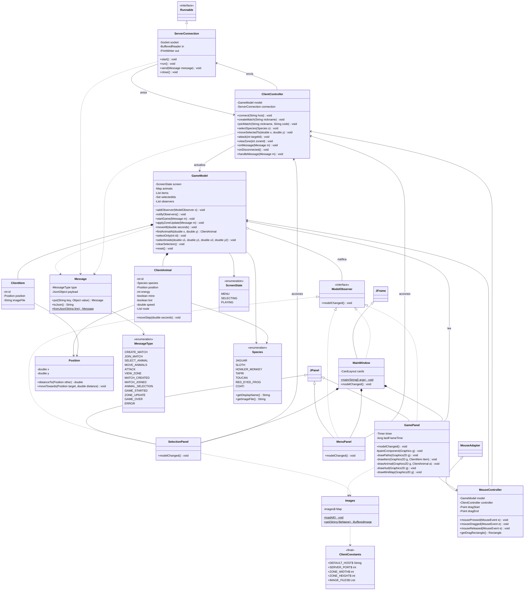

# Jungle Attack - Cliente

Juego de batalla en un bosque de Costa Rica (Java 17, Swing, MVC + Observer). Este repositorio es el **cliente**: dibuja el juego, convierte los clics en mensajes y muestra lo que decide el servidor. El servidor está en otro repositorio (`jungle-attack-server`).

- Especificación completa del cliente: [`Spec-cliente.md`](Spec-cliente.md)
- Los mensajes que se intercambian con el servidor están en la sección 3 de `Spec-admin.md` (repo del servidor).

## Cómo correrlo

```
mvn test                     # pruebas (JUnit 5)
mvn compile exec:java        # abre el juego; servidor por defecto: localhost:5000
```

Tecnologías: Java 17, Maven, Swing, JSVG (imágenes SVG), Gson (JSON), JUnit 5 y GitHub Actions (`mvn test` en cada push).

## Probar el cliente sin el servidor real

`FakeServer` (en `src/test/java/.../tools`) simula una partida de juguete en el puerto 5000: crear o unirse (código `TEST`), el rival ya tiene a `JAGUAR`, animales que caminan por los caminos, cafés, ataques y la bandera rival. Sirve para ver todas las pantallas; **no** reemplaza probar con el servidor real.

```
mvn test-compile exec:java@fake-server     # en una terminal (deja el servidor corriendo)
mvn compile exec:java                      # en otra terminal (abre el juego)
```

Hay que cerrar el servidor falso antes de usar el real, porque los dos usan el puerto 5000.

## Acuerdo con el servidor

- `Message`, `MessageType`, `Position` y `Species` son copias de las del servidor; solo cambia la línea `package`. Si se cambia una en un repo, se avisa y se cambia en el otro.
- Los nombres de los campos de los mensajes son exactamente los de la sección 3 de `Spec-admin.md`.
- Las rutas llegan como `[[x, y], ...]` y los caminos de `GAME_STARTED` como `[x1, y1, x2, y2]`.
- `ClientAnimal.moveStep` es el mismo cálculo que `Animal.moveStep` del servidor.
- Imágenes con los nombres de `Species` y `GameConstants`. Puerto 5000.

## Paquetes (18 clases)

```
src/main/java/com/jungleattack/client/
├── util/        ClientConstants, Position, Images
├── protocol/    MessageType, Message           (copia del servidor)
├── network/     ServerConnection
├── model/       ScreenState, ModelObserver, GameModel, ClientAnimal, ClientItem, Species
├── controller/  ClientController, MouseController
└── view/        MainWindow, MenuPanel, SelectionPanel, GamePanel
```

## Diagrama de clases



## Interpretación de las reglas

Algunas reglas del enunciado se pueden leer de más de una forma. Esta es la interpretación que usamos (las decisiones de juego están en la sección 2 de `Spec-admin.md`).

| Tema | Interpretación |
|---|---|
| "P2P" | Es una partida de jugador contra jugador. La arquitectura es cliente-servidor: los dos clientes nunca hablan entre ellos y todo mensaje pasa por el servidor (sockets, JSON, un mensaje por línea). |
| Código de partida | 4 caracteres alfanuméricos (A-Z y 0-9, por ejemplo `A7K2`), generados por el servidor y únicos entre las partidas activas. La comparación ignora mayúsculas y espacios. El cliente manda el código tal como se escribe. |
| Energía | Es por animal: cada animal del jugador empieza con 20 y cada bot con 10. Un animal muere al llegar a 0. |
| Capacidad de daño | Es del pack y la comparten todos sus miembros (2 en el pack del jugador, 1 en el del bot). Cada ataque le quita esa cantidad de energía al objetivo. |
| "Chocar" | Dos animales se encuentran cuando la distancia entre ellos es menor o igual a `ENCOUNTER_RADIUS` (40 px). |
| Ataque del bot | Automático: cuando un animal del jugador entra en el rango de un pack bot, todos los bots de ese pack que lo alcanzan lo atacan. Los bots no se atacan entre ellos. |
| Ataque del jugador | Nunca es automático. El jugador selecciona animales y hace clic derecho sobre el objetivo (`ATTACK`). Cada animal ataca una vez por segundo mientras el objetivo esté en rango; si muere o se aleja, deja de atacar. |
| Visibilidad (niebla de guerra) | El jugador ve una zona a la vez y solo puede ver zonas donde tiene animales vivos (el minimapa solo deja entrar a esas). El servidor le manda todos sus animales y lo que haya en la zona que ve; si se queda sin animales ahí, lo cambia a otra. `GAME_STARTED` manda las líneas de todos los caminos (la estructura del mapa, no su contenido). |
| Movimiento | Solo por los caminos (un grafo), a velocidad constante. El destino es el nodo más cercano al clic y la ruta se calcula con BFS en el servidor. El cliente mueve a los animales con el mismo cálculo (`moveStep`) y se corrige con cada `ZONE_UPDATE` (como mínimo uno por segundo). |
| Cafés | Son 10, puestos al azar en puertas de los caminos sin repetir. Lo toma el primer animal que lo toca y desaparece. El +1 de daño es para todo el pack y se acumula. |
| Bono de energía | Cada vez que el contador de bots eliminados de un jugador llega a un múltiplo de 2, cada animal vivo de su pack gana +1 de energía, sin pasar de 20. |
| Bandera | Cada jugador tiene su bandera en el centro de su zona inicial. Gana quien entra al radio de la bandera rival y la partida termina. |
| Zonas iniciales | Los 7 packs (2 jugadores y 5 bots) empiezan en 7 zonas distintas, escogidas al azar entre las 12. |
| Pack sin animales | Si a un jugador se le mueren todos sus animales, pierde. |
| Desconexión | Si un jugador se desconecta antes de que entre el otro, la partida se borra. Si se desconecta después, gana el otro. En el cliente se muestra "Se perdió la conexión con el servidor" y se vuelve al menú. |
| Animación | Cada animal avanza por su ruta con el mismo cálculo que el servidor en lugar de interpolar entre dos snapshots. Así el movimiento es continuo con menos mensajes (de 1 a 5 por segundo) y el servidor corrige cualquier diferencia. |
